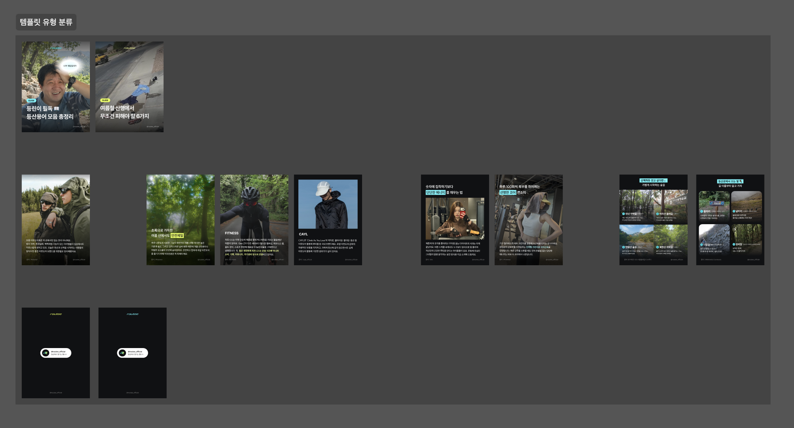
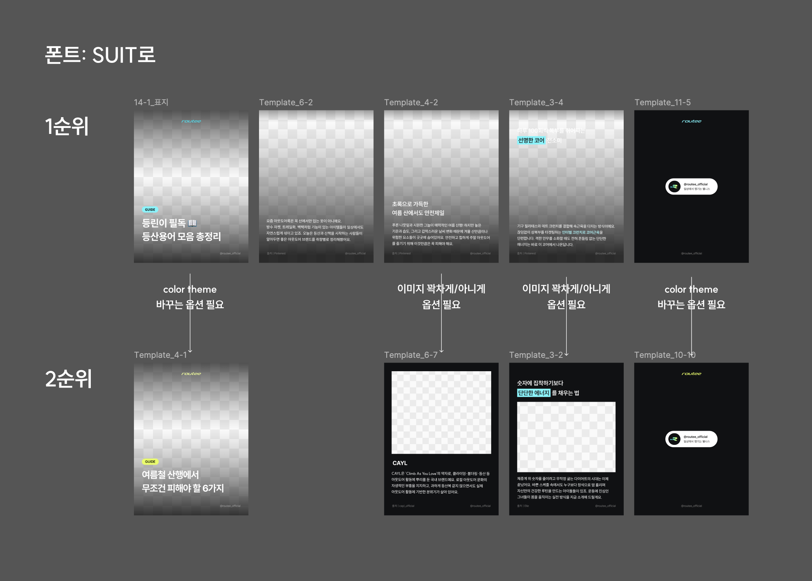

## log-26-11-06

<br>

### 1. 피그마 템플릿 유형화

- 이제까지 만들어온 카드뉴스들을 쭉 보고, 공통적으로 보이는 템플릿들을 모아봤다.


<br>

- 이중 첫 프로토타입에서 생성할 카드뉴스 템플릿을 결정했다.


  - 겉표지 페이지
  - 본문 페이지1 (하단 캡션+배경이미지 조합)
  - 본문 페이지2 (하단 타이틀+하단 캡션+배경이미지 조합)
  - 본문 페이지3 (상단 타이틀+하단 캡션+배경이미지 조합)
  - 마지막 페이지

- 2x2 이미지 그리드로 구성된 본문 페이지 템플릿은 일단 우선순위에서 제외
  - 플러그인 초기 버전 개발 완료 후, 필요시 템플릿 업데이트하는 걸로.

<br>

### 2. 플러그인 작동 플로우 설계

```
[플러그인 실행]
   │
   ▼
code.ts ── figma.showUI() ──▶ UI 화면 열림
   
──────────────── UI (React) ────────────────
   │
   ├─ 1. 카드뉴스 템플릿 유형 선택 (TemplateSelector)
   │     겉표지 / 본문1 / 본문2 / 본문3 / 마지막
   │
   ├─ 2. 입력창 자동 생성 (CardForm)
   │     └─ TEMPLATES[유형].fields 보고 그림
   │          ├─ text      → TextField     (타이틀)
   │          ├─ longtext  → TextAreaField (캡션)
   │          └─ image     → ImageField    (이미지)
   │
   ├─ 3. 이미지 배치 선택 (본문 유형만)
   │     └─ ImageModeToggle: 배경 채우기 / 본문 삽입
   │
   ├─ 4. 이미지 업로드 시
   │     └─ 포맷 검사 → 이미지 리사이징 → 바이트로 변환
   │
   └─ 5. Create 클릭
         ├─ 필수값 없음 → 입력창에 에러 표시
         └─ OK
   
──────────────── code.ts (Figma API) ────────────────
   │
   ├─ onmessage
   │     ├─ cancel      → closePlugin()
   │     └─ create-card → BUILDERS[templateId]
   │
   ├─ builder 실행
   │     ├─ cover   → buildCover
   │     ├─ body-*  → buildBody (titlePosition: none / bottom / top)
   │     └─ ending  → buildEnding
   │
   ├─ 공통 처리
   │     ├─ createCardFrame (1080×1350, 세로 오토레이아웃)
   │     └─ loadFontWithFallback (Pretendard → Noto Sans KR)
   │
   ├─ 본문이면 imageMode 분기
   │     ├─ background
   │     │     ├─ 프레임 fill = 이미지
   │     │     └─ Title / Caption을 하단(또는 위아래)에 배치
   │     └─ inline
   │           ├─ 흰 배경, gap 균일
   │           ├─ Title   (hug)
   │           ├─ Image   (fill, 이미지 꽉 채움)
   │           └─ Caption (hug)
   │
   ├─ 배치: placeNextToLast → 선택 + 화면 이동
   │
   └─ 결과 전송
         ├─ 성공 → postMessage('created') → UI: 완료 표시, 다음 카드 입력
         └─ 실패 → figma.notify + postMessage('error') → UI: 에러 표시
```


<br>

### 3. 폴더 구조 세팅
- 아래처럼 기본 구조 구성함.
- 여기서 조금씩 추가/변경해가며 작업할 예정이다

```
src/
├─ shared/                       ← UI와 plugin이 함께 씀
│  ├─ templates.ts               유형 목록 + 유형별 입력 필드 정의
│  └─ messages.ts                postMessage 타입
│
├─ ui/                           ← React (입력 화면)
│  ├─ main.tsx
│  ├─ App.tsx                    유형 선택 상태 관리 + Create 전송
│  ├─ index.css
│  ├─ components/
│  │  ├─ TemplateSelector.tsx    5개 유형 중 선택
│  │  ├─ CardForm.tsx            선택한 유형의 fields로 입력창 자동 생성
│  │  └─ fields/
│  │     ├─ TextField.tsx        한 줄 입력 (타이틀)
│  │     ├─ TextAreaField.tsx    여러 줄 입력 (캡션)
│  │     └─ ImageField.tsx       이미지 업로드 + 미리보기
│  └─ utils/
│     └─ readImage.ts            File → Uint8Array 변환
│
└─ plugin/                       ← Figma API (프레임 생성)
   ├─ code.ts                    진입점: showUI, 메시지 수신, 분기
   ├─ builders/
   │  ├─ index.ts                유형 ID → 생성 함수 매핑 (분기의 핵심)
   │  ├─ cover.ts                겉표지
   │  ├─ body.ts                 본문 1·2·3 공통 (타이틀 위치 옵션)
   │  └─ ending.ts               마지막 페이지
   ├─ parts/                     여러 유형이 같이 쓰는 조각
   │  ├─ cardFrame.ts            1080×1350 프레임 생성
   │  ├─ backgroundImage.ts      이미지를 배경 fill로 적용
   │  └─ textNode.ts             폰트 로드 + 텍스트 생성
   └─ utils/
      ├─ fonts.ts                폰트 로드 + 대체 폰트 처리
      └─ placement.ts            생성한 프레임을 캔버스에 나란히 배치
```